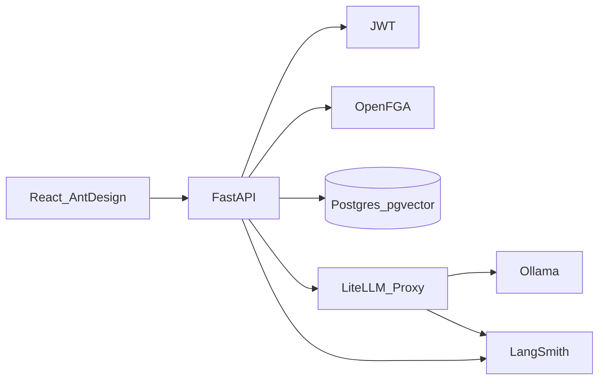

# Architecture

NexusAI keeps the browser, the API, and model providers in separate processes. Milestone 0 runs three of those processes: the dashboard, the API, and PostgreSQL. Later milestones add OpenFGA, LiteLLM, and Ollama without changing the request path below.

The `worldbank` schema holds indicator observations and document metadata. Solid boxes in the running application today are the dashboard, the API, PostgreSQL, and the OpenAI path through LiteLLM. JWT, OpenFGA, the LiteLLM proxy process, Ollama, and LangSmith are the remaining seams. The Admin page runs an OpenFGA Check for two demo users before it returns document text. The debug page reads `llm_traces`.

## Why the split looks like this

Organizations will upload confidential documents and ask questions about private tables. The model must not be the thing that decides who can see a document. The planned request path is:

1. A JWT says who the caller is. OpenFGA is not the login system.
2. The service asks OpenFGA whether that user can view the document or department.
3. The repository loads chunk text only after an allow.
4. The prompt is built from those chunks.
5. Queries also filter `organization_id` from the token, so a missed authorization check still cannot cross organizations.

LiteLLM Proxy will be the only process that knows provider model names. Application code will call aliases such as `chat-default` and `embed-default`. Adding Amazon Bedrock later is a new LiteLLM model entry, not a rewrite of the API.

LangGraph is reserved for the three agents because the report agent needs a human-approval interrupt, a tool allow-list, and a step limit. That runtime is not installed in this milestone.

## Code layout

- `backend/app/api` — HTTP adapters. They validate input and call services.
- `backend/app/services` — use cases. Empty until identity and documents arrive.
- `backend/app/repositories` — SQLAlchemy persistence. Empty until the first business schema.
- `backend/app/ai` — gateway client, retrieval, NL2SQL, and agents.
- `backend/app/authz` — OpenFGA checks. Prompts will not enforce permissions.
- `backend/app/core` — settings, JSON logs, and the async engine.
- `frontend/src` — Ant Design shell. Module routes that are not built yet render a placeholder instead of fake data.

## Database

One PostgreSQL 16 instance with pgvector. Later schemas:

- `app` — tenants, documents, chunks, conversations, agent runs
- `olist` — the nine Olist tables
- `worldbank` — indicator history
- `eval` — NL2SQL cases and run results

The only migration in this milestone creates the `vector` extension. Business tables are not created yet. NL2SQL will use a separate database role that can `SELECT` only inside `olist` and `worldbank`.

## What this milestone deliberately leaves out

There is no login, no document store, and no model call. A health page that pretends those systems are running would hide the real boundary of the foundation.
