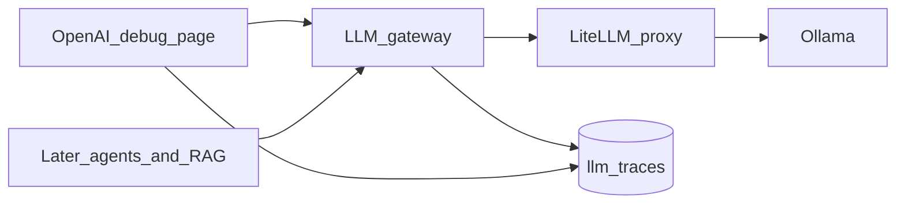

# LLM gateway

NexusAI calls chat models through one module, `backend/app/ai/gateway.py`. Feature code passes the alias `chat-default`. That module is the only place that imports LiteLLM. For local development the module calls the LiteLLM proxy on port 4000, and the proxy calls Ollama. The proxy configuration is `deploy/litellm_config.yaml`.



## Why this shape

Provider SDKs change, and a later Bedrock or Ollama model should not require a rewrite of the assistant. The alias and the concrete model are settings:

- `NEXUS_CHAT_ALIAS` defaults to `chat-default`
- `NEXUS_CHAT_MODEL` for the local proxy route is `openai/chat-default`
- `NEXUS_CHAT_API_BASE` for that route is `http://127.0.0.1:4000`
- The proxy maps `chat-default` to Ollama model `qwen2.5:3b`

`OPENAI_API_KEY` is read from the environment and from the repository-root `.env`. It is not a `NEXUS_` setting name, because that is the variable OpenAI and LiteLLM already use. The key is excluded from the settings representation, from logs, and from the trace table. Text that looks like an `sk-` secret is replaced with `[redacted]` before it is stored or sent.

Timeouts and retries are `NEXUS_LLM_TIMEOUT_SECONDS` and `NEXUS_LLM_MAX_RETRIES`. LiteLLM performs the retries. One trace row is written for the finished attempt, including the failure if the retries are exhausted.

## What a trace contains

Each row in `llm_traces` records the source, alias, model, status, latency, token counts, request messages, response text, the provider response id, and the error type and message. The debug page at `/debug` lists those rows and opens the full request and response. It refreshes every five seconds.

A test prompt on that page uses the same gateway as every future caller. The source is `debug-page`, so a manual check is distinguishable from an assistant call.

Local runs store traces in SQLite at `data/debug/llm_traces.db`, which is gitignored. Docker Compose points `NEXUS_TRACE_DATABASE_URL` at PostgreSQL, and Alembic revision `0002_llm_traces` creates the same table there.

## What this does not do yet

The in-app page records every call the API sends to the proxy. The proxy's own spend log records the same call only after it arrives on port 4000. LangSmith export is still a later milestone. A direct call to Ollama on port 11434 does not appear in the proxy log.

## How to test

Unit tests replace `call_model` and assert that a success stores tokens and that a missing key or a timeout stores an error. They also assert that the HTTP payloads do not contain `api_key`.

With a real key in `.env`:

```bash
cd backend
uv pip install --python .venv/bin/python -e ".[dev]"
.venv/bin/uvicorn app.main:app --host 127.0.0.1 --port 8000
```

Open `http://127.0.0.1:5173/debug`, send a short prompt, and open the new row. A missing key still produces an error row with `error_type` `not_configured`.

Official references:

- [LiteLLM completion](https://docs.litellm.ai/docs/completion)
- [OpenAI API keys](https://platform.openai.com/api-keys)
- [OpenAI chat completions](https://platform.openai.com/docs/api-reference/chat)
